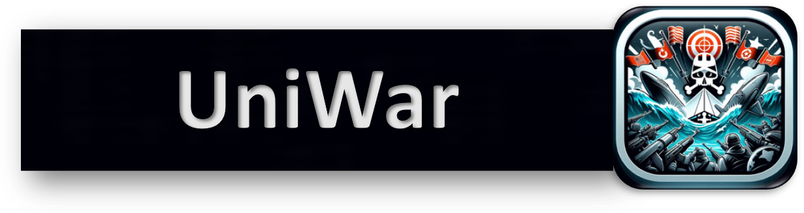
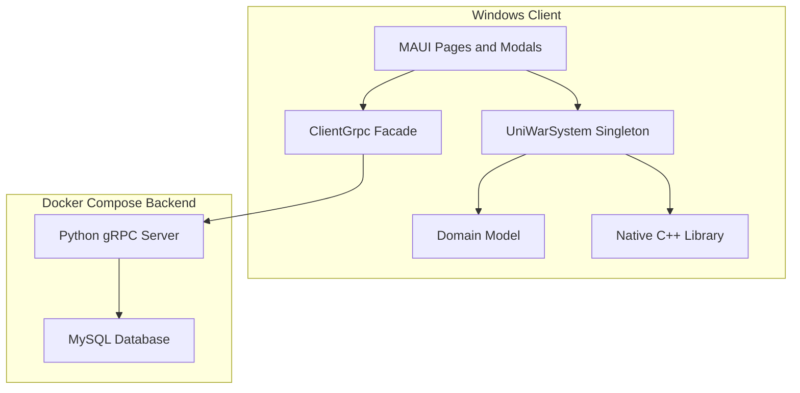
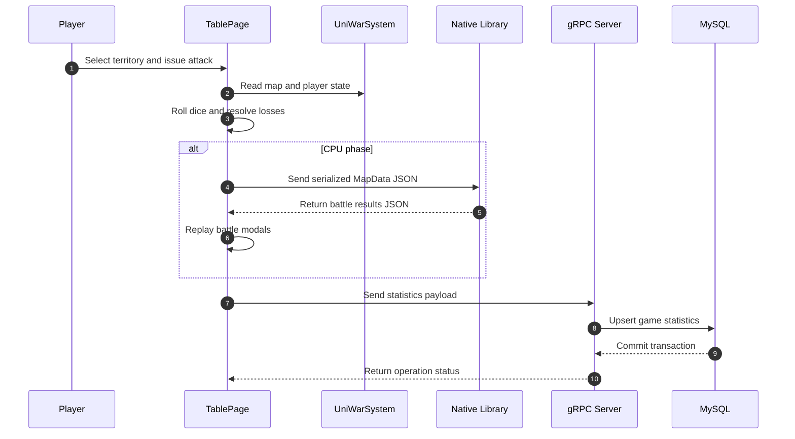
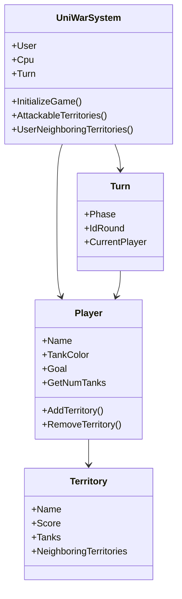

# UniWar

UniWar is a Windows desktop implementation of a turn-based strategy board game
inspired by RisiKo!. A .NET MAUI client renders the world map and manages the
match, while a native C++ library implements the CPU opponent and a Python gRPC
server provides authentication, game history, and persistent statistics backed
by MySQL.



## Overview

The application supports two play modes:

- **Offline mode** runs entirely on the client. The C++ library drives the CPU
  phases and no network services are required.
- **Online mode** authenticates users through the gRPC server, stores matches
  and statistics in MySQL, and retrieves game history and aggregate metrics.

Core capabilities:

- 42 territories grouped into 6 continents with an adjacency graph.
- Two players receive 21 territories each and three tanks per territory.
- Three-phase turns: reinforcement, attack, and strategic shift.
- Dice-based combat with attacker and defender loss resolution.
- Native CPU logic for reinforcement distribution, multi-battle attacks, and
  strategic shifts.
- Victory condition: control at least 3 continents and at least 28 territories.
- Online history view with base64-rendered outcome charts.
- Online statistics view covering losses, defenses, ownership, and continents.

The current user interface strings are in Italian; the source documentation and
this README are in English.

## System Architecture

The solution combines three runtime layers:

1. **.NET MAUI client** — pages and modals under `UniWar/Views`, domain types
   under `UniWar/Models`, serialization structs under `UniWar/Structs`, and the
   typed gRPC facade in `UniWar/ClientGrpc.cs`.
2. **Native C++ library** — `UniWar/cppLibrary/functions_lib.cpp` exposes
   `reinforcement`, `cpuAttack`, and `winCheck` through a C ABI consumed by
   P/Invoke. Game state crosses the boundary as JSON serialized with
   `System.Text.Json` and parsed with `nlohmann/json`.
3. **Python gRPC backend** — `UniWar/pythonServer/server.py` implements the
   `StatisticsService` contract declared in `UniWar/Protos/statistics.proto`.
   Persistence is split into command and query services, and charts are rendered
   with Matplotlib.

Key design patterns:

- **Singleton** — `UniWarSystem.Instance` owns the game catalog and active
  players; `TablePage.Instance` owns the active game page.
- **Facade** — `ClientGrpc` isolates the generated gRPC client from the UI.
- **State machine** — `Turn.Phase` drives the reinforcement, attack, and
  strategic-shift transitions.
- **Command/query separation** — the Python service layer separates write
  commands from read queries.
- **Native adapter** — JSON DTOs (`MapData`, `BattleResult`,
  `StatisticsCollection`) decouple managed and native representations.

### Component Diagram



### Battle Data Flow



### Domain Model



### Repository Layout

```text
.
├── README.md
├── .gitattributes
├── .gitignore
├── .vscode/
│   └── settings.json
└── UniWar/
    ├── UniWar.sln
    ├── UniWar.csproj                 # MAUI project, Windows-only target
    ├── App.xaml / App.xaml.cs        # Application bootstrap
    ├── AppShell.xaml / .cs           # Shell navigation and route registration
    ├── MauiProgram.cs                # Fonts, logging, Windows window geometry
    ├── ClientGrpc.cs                 # Typed gRPC client facade
    ├── Models/
    │   ├── UniWarSystem.cs           # Singleton game state and map graph
    │   ├── Player.cs                 # Participant state and territory ownership
    │   ├── Territory.cs              # Territory score, garrison, and neighbors
    │   ├── Tank.cs                   # Tank color and icon mapping
    │   ├── Turn.cs                   # Active player, phase, and round
    │   ├── Continent.cs              # Continent and territory grouping
    │   └── Goal.cs                   # Player objective
    ├── Enums/
    │   ├── TankColors.cs
    │   └── TurnPhases.cs
    ├── Extensions/
    │   ├── ListExtension.cs          # Fisher-Yates shuffle
    │   └── StringExtension.cs        # Territory name formatting
    ├── Structs/
    │   ├── MapData.cs                # Native boundary input model
    │   ├── BattleResult.cs           # Native boundary battle output
    │   └── StatisticsCollection.cs   # gRPC statistics payload
    ├── Protos/
    │   ├── statistics.proto          # gRPC contract
    │   ├── StatisticsGrpc.cs         # Generated C# client
    │   ├── statistics_pb2.py         # Generated Python messages
    │   └── statistics_pb2_grpc.py    # Generated Python service stubs
    ├── Views/
    │   ├── Pages/
    │   │   ├── SignInUp.xaml / .cs   # Authentication and offline entry point
    │   │   ├── MainPage.xaml / .cs   # Home page and history access
    │   │   ├── InitializationSummary.xaml / .cs
    │   │   └── TablePage.xaml / .cs  # Main game board and turn loop
    │   └── Modals/                   # Battle, statistics, history, and dialogs
    ├── Platforms/
    │   └── Windows/                  # WinUI entry point and manifests
    ├── Resources/
    │   ├── Images/                   # Map, tanks, dice, icons, banner
    │   ├── Styles/                   # Colors and control styles
    │   ├── Fonts/
    │   ├── AppIcon/
    │   ├── Splash/
    │   └── Raw/
    ├── cppLibrary/
    │   ├── uniwar_lib.hpp / .cpp     # Player graph, dice, win condition
    │   ├── functions_lib.hpp / .cpp  # Exported CPU reinforcement and attack
    │   ├── json.hpp                  # nlohmann/json single-header library
    │   ├── build.bat                 # MinGW x64 DLL build script
    │   └── functions_lib.dll         # Prebuilt native library
    ├── pythonServer/
    │   ├── server.py                 # gRPC service implementation
    │   ├── uniwar/
    │   │   ├── command_service.py    # Registration, games, statistics writes
    │   │   ├── query_service.py      # Authentication and history reads
    │   │   ├── functions.py          # Aggregation and chart rendering
    │   │   └── db_config.py          # MySQL connection settings
    │   ├── Db/
    │   │   └── init.sql              # Users, Games, and Data schema
    │   └── dockerfiles/
    │       ├── dockerfile-server     # Python 3.9 gRPC image
    │       └── dockerfile-db         # MySQL image and seed schema
    └── docker-compose.yml            # Server and database orchestration
```

## Prerequisites

| Requirement | Version / Notes |
| --- | --- |
| Operating system | Windows 10 version 1809 or later, or Windows 11 |
| .NET SDK | 8.0 |
| .NET MAUI workload | Installed through `dotnet workload install maui` |
| IDE | Visual Studio 2022 17.8 or later with the MAUI workload, or VS Code |
| C++ compiler | MinGW-w64 `g++` with 64-bit support, required only to rebuild the native DLL |
| Docker | Docker Desktop with Docker Compose, required only for online mode |
| Python | Not required on the host; the server runs in the Docker image |

The prebuilt `UniWar/cppLibrary/functions_lib.dll` is sufficient to run the
client. Rebuilding it is necessary only after modifying the C++ sources.

## Installation

1. Clone the repository:

   ```powershell
   git clone <repository-url>
   cd UniWar
   ```

2. Install the .NET 8 SDK and the MAUI workload:

   ```powershell
   dotnet workload install maui
   dotnet workload list
   ```

3. Rebuild the native library when the C++ sources change:

   ```powershell
   cd UniWar\cppLibrary
   .\build.bat
   cd ..\..
   ```

4. Build the MAUI application:

   ```powershell
   cd UniWar
   dotnet build UniWar.sln -f net8.0-windows10.0.19041.0
   ```

5. Start the online backend:

   ```powershell
   cd UniWar
   docker compose up --build
   ```

   The server listens on port `50051` and the MySQL container is named
   `mysql_container`. The first startup initializes the schema from
   `pythonServer/Db/init.sql`.

6. Run the client from Visual Studio by selecting the `Windows Machine`
   target, or from the command line:

   ```powershell
   dotnet run --project UniWar.csproj -f net8.0-windows10.0.19041.0
   ```

## Configuration

No `.env` file is read by the current implementation. Configuration is
source-based and must be kept consistent across the client, server, and
container definitions.

| Setting | Location | Default |
| --- | --- | --- |
| gRPC endpoint | `UniWar/ClientGrpc.cs` | `http://localhost:50051` |
| gRPC listen port | `UniWar/pythonServer/server.py`, `UniWar/docker-compose.yml` | `50051` |
| Database host | `UniWar/pythonServer/uniwar/db_config.py` | `mysql_container` |
| Database name | `UniWar/pythonServer/uniwar/db_config.py`, `UniWar/pythonServer/dockerfiles/dockerfile-db` | `uniwar` |
| Database credentials | `UniWar/pythonServer/uniwar/db_config.py`, `UniWar/pythonServer/dockerfiles/dockerfile-db` | Development defaults |
| Game rules | `UniWar/Models/UniWarSystem.cs`, `UniWar/cppLibrary/*.cpp` | 42 territories, 21 per player, 28 territories and 3 continents to win |

The database credentials committed in this repository are development defaults.
Externalize them and restrict network exposure before deploying the backend
outside a local environment.

### Database Schema

| Table | Purpose |
| --- | --- |
| `Users` | Unique username and bcrypt password hash |
| `Games` | Game owner, creation date, and final state: `-1` unfinished, `0` loss, `1` win |
| `Data` | Per-game statistics, including round state, JSON ownership lists, losses, perfect defenses, and the active turn flag |

### gRPC API

| RPC | Request | Response | Purpose |
| --- | --- | --- | --- |
| `sign_up` | `SignUpCredentials` | `Response` | Register a user |
| `sign_in` | `SignInCredentials` | `Response` | Authenticate a user |
| `username_check` | `Username` | `Response` | Validate and check username availability |
| `new_game` | `Username` | `NewGameResponse` | Create a game record |
| `end_game` | `EndGameRequest` | `Response` | Store the final outcome |
| `send_data` | `DataRequest` | `Response` | Upsert battle statistics |
| `get_statistics` | `StatisticRequest` | `StatisticsResponse` | Retrieve aggregate metrics |
| `get_games` | `Username` | `GameInfoList` | Retrieve history and outcome chart |

## Usage

### Offline Match

1. Launch the application.
2. Select the offline mode option on the authentication page.
3. Start a new game and review the initialization summary.
4. During reinforcement, click an owned territory to place one tank at a time.
5. During attack, select the attacking territory, choose a target, and confirm
   the dice result.
6. During the strategic-shift phase, choose a source and destination territory
   and specify the number of tanks to move.
7. End the game after the third round to compare territory scores.

### Online Match

1. Start the backend:

   ```powershell
   cd UniWar
   docker compose up --build
   ```

2. Verify that both containers are running:

   ```powershell
   docker compose ps
   docker compose logs -f server-grpc
   ```

3. Launch the client, sign up or sign in, and start a new game.
4. Use the statistics button during a match to inspect the current game.
5. Use the history view from the main page to inspect previous games and the
   outcome chart.

### Backend Lifecycle

```powershell
# Start or rebuild the backend
cd UniWar
docker compose up --build

# Stop the backend while keeping the database volume
docker compose down

# Stop the backend and delete the database volume
docker compose down -v
```

### Native Library Rebuild

```powershell
cd UniWar\cppLibrary
.\build.bat
```

The script compiles `uniwar_lib.cpp` and `functions_lib.cpp`, then links
`functions_lib.dll` together with the import library `libfunctions_lib.a`.
The DLL is copied to the client output directory by `UniWar.csproj`.

### Direct RPC Invocation

When `grpcurl` is installed, the backend can be queried directly:

```powershell
grpcurl -plaintext -import-path UniWar\Protos -proto statistics.proto `
  -d '{"username":"Alice"}' localhost:50051 statistics.StatisticsService/new_game
```

## Verification

The repository does not contain an automated test suite. The following manual
checks cover the main execution paths:

- **Startup** — the shell opens the authentication page and the offline entry
  point reaches the main page.
- **Game initialization** — 42 territories are distributed 21 to each player,
  each territory starts with three tanks, and the turn order is randomized.
- **Reinforcement** — the user receives `owned territories / 2` tanks; the CPU
  distributes its reinforcements through the native library.
- **Attack** — up to three dice per side are rolled, losses are applied, and
  conquest moves tanks through the `ConqueredTerritoryModal`.
- **Victory** — the native `winCheck` confirms the 28-territory and
  3-continent condition.
- **Persistence** — with the backend running, `send_data`, `end_game`,
  `get_games`, and `get_statistics` update and read the MySQL tables.
- **Offline isolation** — no gRPC calls are issued while offline mode is active.

### Troubleshooting

| Symptom | Resolution |
| --- | --- |
| `functions_lib.dll` not found | Rebuild it with `build.bat` and confirm the x64 configuration |
| `BadImageFormatException` | Rebuild the native library for the same architecture as the client |
| gRPC calls fail | Start `docker compose up --build` and verify port `50051` is free |
| Database connection error | Ensure the container is healthy and that `db_config.py` matches the credentials in `dockerfile-db`; restart `server-grpc` after MySQL finishes initializing |
| MAUI workload missing | Run `dotnet workload install maui` and restart the terminal or IDE |

## License

No license file is included in this repository. Contact the repository owners
before redistributing the code or assets.
